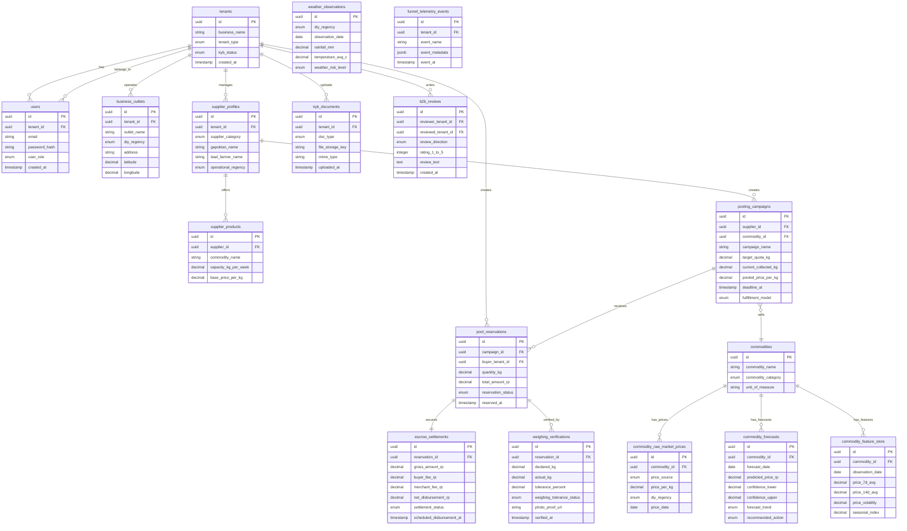

# Database Schema - PasokMataram

## Entity Relationship Diagram

## Table Descriptions

### Core Entities

**tenants** - Multi-tenant root entity (HOREKA buyers or GAPOKTAN suppliers)  
**users** - User accounts with RBAC (SUPER_ADMIN, OWNER, PROCUREMENT_MANAGER, KITCHEN_STAFF)  
**business_outlets** - Physical locations for HOREKA buyers across DIY regencies  
**supplier_profiles** - Supplier metadata (farmer groups, cooperatives, processors)

### Product & Pooling

**commodities** - Master commodity catalog (vegetables, fruits, protein)  
**supplier_products** - Products offered by suppliers with capacity & base price  
**pooling_campaigns** - Group buying campaigns with target quota & deadline  
**pool_reservations** - Buyer reservations joining pooling campaigns

### Payment & Settlement

**escrow_settlements** - Escrow vault records with BPD DIY (dual-rail fees: 0.3% buyer, 0.5% merchant)  
**weighing_verifications** - QC hub digital scale verification with photo proof

### KYB & Compliance

**kyb_documents** - KYB document uploads (NIB, KTP, NPWP, Surat Keterangan Tani)

### ML & Forecasting

**commodity_raw_market_prices** - Historical price data from BAPANAS, PIHPS, internal escrow  
**commodity_forecasts** - LightGBM price predictions with confidence intervals  
**commodity_feature_store** - Engineered features for ML (7d avg, volatility, seasonal index)  
**weather_observations** - Weather data for supply risk modeling

### Analytics

**b2b_reviews** - Bidirectional reviews (buyer ↔ supplier trust scoring)  
**funnel_telemetry_events** - User behavior tracking for conversion optimization

## Key Design Patterns

1. **Multi-tenancy via RLS**: Row-level security policies enforce tenant isolation
2. **Branded Types**: UUIDs typed as `TenantId`, `UserId`, `CommodityId` for type safety
3. **Audit timestamps**: All tables have `created_at`, critical tables have `updated_at`
4. **Enum types**: PostgreSQL native enums for status fields (type-safe, indexed)
5. **Decimal precision**: Money & weights use `NUMERIC(10,2)` to avoid float errors
6. **Geospatial**: DIY regency enum + lat/long for logistics routing
7. **JSONB metadata**: Flexible telemetry events without schema migrations

## Indexes (Performance)

- Primary keys: UUID v4 with `uuid_generate_v4()`
- Foreign keys: Indexed for join performance
- Query hot paths: `tenant_id`, `created_at`, `reservation_status`
- Full-text search: Commodity names, supplier names (optional GIN index)

## Security

- **RLS policies**: `buyer_tenant_id = current_tenant_id` enforcement
- **Password hashing**: Argon2id (memory-hard, GPU-resistant)
- **JWT tokens**: HS256 with signature validation
- **File upload**: Magic byte validation, MIME whitelist
- **Rate limiting**: Redis-based (5 login/15min, 100 API/min)

## Constraints

- **Check constraints**: `total_amount_rp >= 500000` (MTV enforcement)
- **Foreign keys**: Cascade delete for dependent records
- **Unique constraints**: `(tenant_id, email)` for users
- **Not null**: Critical fields enforced at DB level
